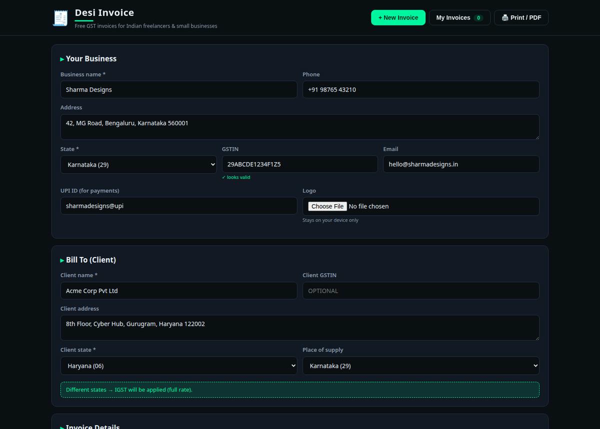
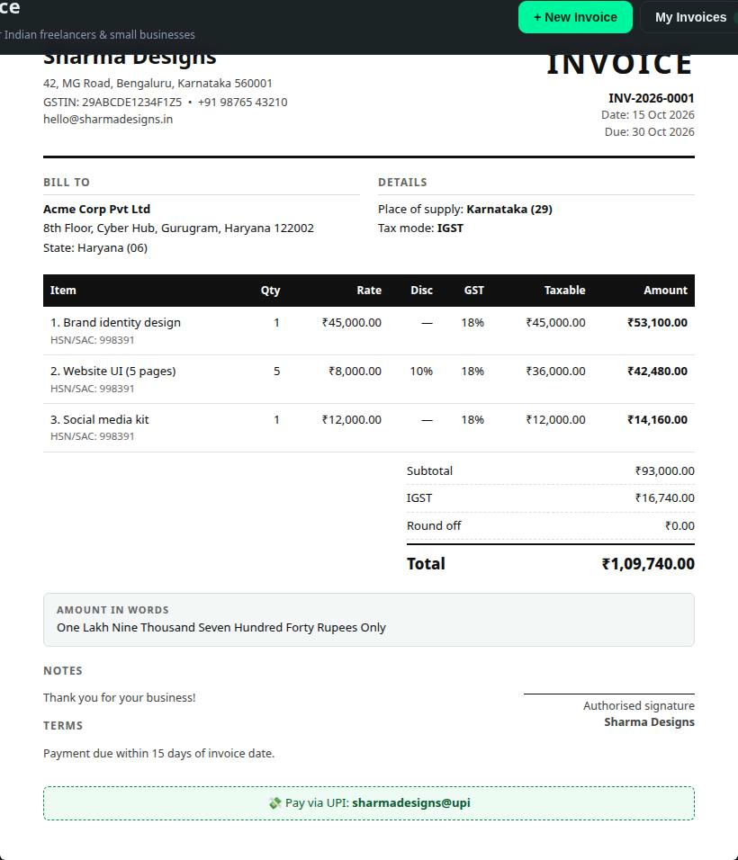

```bash
root@prabh:~# ./desi-invoice --mode ghost
> GST invoice generator // OFFLINE // ZERO SIGNUP // ZERO TRACKING
> STATUS: OPERATIONAL ✔
```

<p align="center">
  <a href="https://thegreatprabh.github.io/Desi-Invoice/">
    
  </a>
</p>

<p align="center">
  
  
  
  
</p>

# DESI INVOICE

**Free, offline-first GST invoice generator for Indian freelancers & small businesses.**

Paid billing apps want your money. Sketchy "free" tools want your data. **Desi Invoice** wants neither — it runs entirely in your browser. No account. No server. No tracking. Open it, fill it, print it.

### ⚡ Arsenal

- **Real GST logic** — same state → CGST + SGST auto-split · different states → IGST. Just like the law says.
- **GSTIN validation** — instant format check as you type.
- **Amount in words** — proper Indian numbering (lakh / crore), because CAs care.
- **Smart invoice numbering** — auto `INV-2026-0001` sequence, never think about it.
- **Line items** — HSN/SAC, quantity, rate, per-item GST slab (0/5/12/18/28%), discount %.
- **Print / Save as PDF** — pixel-clean A4 invoice, exactly what you see in the preview.
- **Business profiles + invoice history** — saved in your browser, duplicate old invoices in one click.
- **Logo upload & UPI ID** — look professional, get paid faster.
- **100% private** — localStorage only. Your client data never leaves your device.

### 📸 Intel

<p align="center">
  
  <br><sub>Fill in business, client & items — live preview updates instantly</sub>
</p>

<p align="center">
  
  <br><sub>Print-ready invoice with GST breakup & amount in words</sub>
</p>

### 🚀 Deployment

**Option 1 — instant:** open `index.html` in any browser. Done.

**Option 2 — hosted:** enable GitHub Pages on this repo (`Settings → Pages → main branch`) and share your link.

No build step. No dependencies. No npm. It just works — even offline.

### 🧠 Tax engine

| Situation | Applied as |
|---|---|
| Business & client in the **same state** | **CGST + SGST** (rate split equally) |
| Business & client in **different states** | **IGST** (full rate) |

Place of supply is editable per invoice. Round-off is applied per standard practice and shown transparently.

> ⚠️ Desi Invoice is a tool, not a tax advisor. GST rules change — verify slab rates and HSN codes for your trade, and consult your CA for edge cases.

### 🛠️ Stack

Vanilla HTML + CSS + JS. Zero dependencies, zero build. The whole app is ~35KB.

```
desi-invoice/
├── index.html      # app shell
├── css/styles.css  # dark UI + print stylesheet
└── js/app.js       # GST engine, state, rendering
```

### 🤝 Join the operation

Found a bug? GST rule nuance I missed? Open an issue or PR — this is built for the community.

### 📄 License

MIT — free forever, for everyone.

---

<p align="center"><sub>// built in the dark, shipped for the light 🇮🇳 — if it saved you money, drop a ⭐</sub></p>
